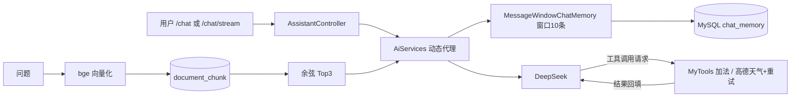

# java-langchain4j-agent

基于 LangChain4j 1.23 + Spring Boot 3.4 的多用户 AI Agent 对话服务，接入 DeepSeek（OpenAI 兼容接口）。

核心链路：请求 → 会话记忆加载（MySQL 持久化）→ 提示词组装 → DeepSeek 推理 → 工具调用（高德真实 API）→ 结果回填再推理 → 同步/SSE 流式响应；支持 RAG 文档问答。

## 功能特性

- **多用户会话隔离**：@MemoryId + ChatMemoryProvider，滑动窗口 10 条；自定义 ChatMemoryStore 将对话 JSON 序列化 UPSERT 持久化至 MySQL，服务重启后会话不丢失
- **工具容错**：错误按"再试一次结果是否变化"分为瞬时/业务/永久三类；瞬时错误指数退避重试（2 次，1s→2s，15s 总预算），耗尽或永久错误回填模型重新规划
- **真实第三方 API**：高德地理编码（中文名→adcode 懒加载缓存）+ 天气实况；HTTP 超时 3s/5s；先判 status 再取数据，按 infocode 分流错误原因回填模型
- **SSE 流式**：TokenStream + SseEmitter 同步/流式双模式，AtomicBoolean 原子守卫防止异步回调重复收尾；附 EventSource 网页聊天界面
- **RAG 知识问答**：文档分块 → 进程内 bge-small-zh 向量化 → MySQL 存储 → 手写余弦相似度 Top3 检索 → ContentRetriever 自动注入

## 主链路



## 实验与踩坑记录

项目按"设计 → 实现 → 制造故障验证"的方式开发，完整记录见 [docs/项目学习笔记.md](docs/项目学习笔记.md)，精选：

- **滑动窗口截断实验**：通读 MessageWindowChatMemory 源码做预言并实测——SystemMessage 豁免、工具调用对成对淘汰（窗口 10→9 抖动）、模型对遗忘无感知的盲区
- **容错对照实验**：构造故障开关制造瞬时/永久错误，对照验证重试路径与模型自愈路径
- **外部 API 错误形态实测**：高德业务错误返回 HTTP 200 + status:"0"（infocode 10001 Key 无效 / 30001 无数据，分流处理）
- **RAG 实测**：增强消息默认写入会话记忆导致 token 成本成倍增长；markdown 表格被分块切碎对检索质量的影响

## 快速开始

环境：JDK 17、MySQL 8、DeepSeek API Key、高德开放平台 Key（Web 服务类型）

1. 建库 `CREATE DATABASE agent_db;`（表结构由 schema.sql 启动时自动创建）
2. 配置环境变量：`DEEPSEEK_API_KEY`、`AMAP_KEY`、`DB_USERNAME`、`DB_PASSWORD`
3. 运行 `org.example.Main`
4. RAG 语料：将 .md/.txt 放入 `docs/` 目录，执行 `curl -X POST localhost:8080/rag/ingest`
5. 使用：
   - 同步对话 `GET /chat?message=...&memoryId=user1`
   - 流式对话 `GET /chat/stream?...`（SSE，网页版直接访问 `localhost:8080/`）
   - RAG 检索 `GET /rag/search?query=...`

## 技术栈

Java 17 / Spring Boot 3.4（MVC、JDBC、RestClient）/ LangChain4j 1.23（AiServices、Tools、ChatMemory、RAG）/ MySQL 8 / DeepSeek / 高德开放平台

## 项目结构

```
src/main/java/org/example
├── Main.java                 启动类
├── Assistant.java            AI 服务接口（同步 + 流式双方法）
├── AssistantController.java  /chat、/chat/stream（SSE）
├── ModelConfiguration.java   模型与 AiServices 装配
├── MyTools.java              工具（加法 / 高德天气 + 错误分类重试）
├── MysqlMemoryStore.java     会话记忆持久化（ChatMemoryStore）
├── RagService.java           RAG：分块入库 / 余弦检索
└── IngestController.java     /rag/ingest、/rag/search
docs/项目学习笔记.md          实验与踩坑记录（同时是 RAG 语料）
```
